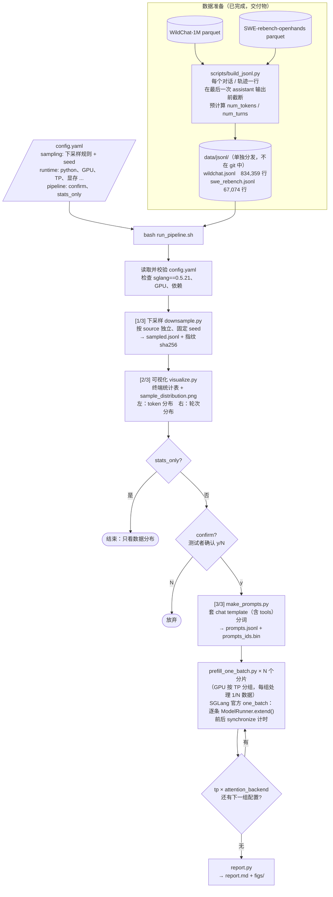

# gpubench：Prefill 效率评测

测量某张推理卡上 **Qwen3-8B-FP8 的纯 prefill 计算效率**。

每条请求是一段完整的对话（system / user / assistant / tool 消息组成的 message list），前面的所有消息都作为上下文。我们测的是：模型开始生成 assistant 回复之前，处理这段输入（prefill）花了多少时间。

计时直接使用 SGLang 官方的 `one_batch` 基准工具，每条请求单独调用一次 `ModelRunner.extend()`，前后各同步一次 GPU，只计 prefill 本身的时间。因此**测量里不包含 server、HTTP、调度器、chunked prefill 等部署层面的开销**。

## 一条命令运行

```bash
bash run_pipeline.sh            # 读取 ./config.yaml
```

所有参数都写在 [`config.yaml`](config.yaml) 里，例如用哪个 python、哪几张 GPU、下采样规则等，命令行上不需要再传参数。如果要用另一份配置，就把它的路径传进去：`bash run_pipeline.sh my.yaml`。

另外有两个可选开关，它们会覆盖 yaml 里对应的设置：

- `--stats-only`：只做下采样和可视化，不跑测试；
- `--yes`：可视化之后不再询问，直接开始测试。

## 流程图



## 运行流程（中文说明）

### 0. 准备环境（测试者，一次性）

```bash
pip install sglang==0.5.21 pyyaml matplotlib
```

然后修改 `config.yaml` 里的 `runtime` 部分，至少要确认这几项：`python`（装了上面这些包的 python）、`model`、`gpus`。如果要计算 MFU，还要填 `peak_tflops`。

### 1. 读取配置并做检查

`run_pipeline.sh` 会先用 [`scripts/load_config.py`](scripts/load_config.py) 读取并校验 yaml。常见的配置错误会直接报错退出，比如缺少字段、`max_input_tokens` 不小于 `context_length`、长度分段不是递增的。

然后检查运行环境：`runtime.python` 能否导入所需的包、sglang 版本是不是 0.5.21、GPU 编号是否存在。

本次使用的 `config.yaml` 会复制一份到结果目录，方便以后复现。

### 2. [1/3] 下采样

[`scripts/downsample.py`](scripts/downsample.py) 按 `config.yaml` 里 `sampling` 一节的规则，从完整 jsonl 中抽样，每个 source 单独处理：

1. 丢掉 token 数小于 `min_tokens`、或者大于 `max_input_tokens` 的行；
2. token 数小于 `short_len` 的短请求，只按 `short_keep` 的比例随机保留；
3. 从剩下的行里不放回地均匀抽 `num_samples` 条。如果剩下的不够，就全部保留。

随机数生成器是 `numpy.random.default_rng([seed, crc32(source 名)])`，所以**同样的数据加同样的配置，抽出来的样本逐字节一致**。`sample_manifest.json` 里记录了被选中样本 id 的 sha256 指纹，可以用来核对两边抽到的是不是同一批数据。

这一步只读取每行开头的长度字段，所以 22GB 的数据十几秒就能抽完。

### 3. [2/3] 可视化

[`scripts/visualize.py`](scripts/visualize.py) 会在终端打印统计表：

- 每个 source 的请求数、token 总数、长度的均值 / p50 / p90 / p99 / 最大值，以及轮次统计；
- 各长度区间的请求数，以及它们在请求数和 token 总数中的占比。

同时保存一张图 `dataset/sample_distribution.png`：**左图是 token 分布，右图是轮次分布**，不同 source 用不同颜色区分。

如果配置了 `pipeline.confirm: true`，测试者看完统计结果后需要输入 `y`，才会进入下一步。

### 4. [3/3] 纯 prefill 测试

1. [`scripts/make_prompts.py`](scripts/make_prompts.py) 把每条样本的 `messages`（以及 `tools`）套上 Qwen3 的 chat template（`add_generation_prompt=True`、`enable_thinking=False`），再分词，结果写入 `prompts.jsonl` 和 `prompts_ids.bin`。
2. [`scripts/prefill_one_batch.py`](scripts/prefill_one_batch.py) 在 SGLang 官方 `sglang.benchmark.one_batch`（[官方文档](https://github.com/sgl-project/sglang/blob/main/docs/docs/developer_guide/benchmark_and_profiling.mdx)）的基础上，只替换了它的 `load_model` 函数，其他都用官方原样的逻辑。模型在每个 rank 上加载好以后，脚本逐条执行官方的 `extend()`，前后各调用一次 device synchronize 来计时；跑完我们的数据后，再交回官方流程收尾。
3. GPU 按 `tp` 分组。例如 4 张卡、`tp: [1]` 时，会起 4 个独立进程，每个进程处理 1/4 的数据，相当于数据并行。`tp` 和 `attention_backend` 如果写了多个值，会对每种组合各跑一遍。
4. 测试期间会用 nvidia-smi 记录 GPU 利用率和功耗。

### 5. 报告

[`scripts/report.py`](scripts/report.py) 生成 `report.md`，内容包括：

- 本次使用的配置和运行环境；
- 数据分布；
- 每组配置的总 token 数、纯计算时间、**tok/s/GPU** 和 **MFU**；
- 按长度分桶统计的延迟（p50 / p90）、吞吐和 MFU；
- 延迟 / 吞吐 / MFU 随长度变化的散点图，以及 GPU 利用率曲线。

## config.yaml 主要参数

| 位置 | 参数 | 默认值 | 说明 |
|---|---|---|---|
| `paths` | `data_dir` | `data/jsonl` | 完整 jsonl 所在目录 |
| | `out_dir` | `auto` | 结果目录；`auto` 表示 `results/<时间戳>` |
| `sampling` | `seed` | 20261013 | 下采样随机种子 |
| | `max_input_tokens` | 131000 | 长度上限，必须小于 `context_length` |
| | `sources[].num_samples` | wildchat 90000 / swe 10000 | 每个 source 抽多少条 |
| | `sources[].short_len` / `short_keep` | wildchat 512 / 0.1 | 短 query 下采样规则 |
| `runtime` | `python` | `python3` | 装有 sglang==0.5.21 的 python |
| | `model` | `Qwen/Qwen3-8B-FP8` | 模型路径或 HF id |
| | `gpus` / `tp` | `[0]` / `[1]` | 使用的 GPU 和 TP；`tp` 写多个值就会扫参 |
| | `attention_backend` | `[default]` | 写多个值就会扫参 |
| | `mem_fraction_static` | 0.7 | KV 池占的显存比例。出现 OOM 就调小；日志里出现 `skip ... > KV capacity` 就调大 |
| | `context_length` / `yarn` | 131072 / auto | 上下文超过 40k 时会自动开启 YaRN |
| | `batch_tokens` | 0 | 0 表示每条请求单独一次 prefill；大于 0 时，会把多条请求拼进同一次 `extend()`，直到达到这个 token 数 |
| | `max_requests` | 0 | 每个分片最多跑多少条，调试时用 |
| | `extra_server_args` | `""` | 其他 SGLang 参数，比如 `--fp8-gemm-backend cutlass` |
| | `peak_tflops` | 0 | 单卡峰值，用于计算 MFU |
| `pipeline` | `confirm` / `stats_only` | true / false | 测试前是否要求确认；是否只做统计 |

## 数据（交付物）

| 文件 | 行数 | 大小 | 一行是什么 |
|---|---|---|---|
| `data/jsonl/wildchat.jsonl` | 834,359 | 3.9 GB | 一个 WildChat 对话 |
| `data/jsonl/swe_rebench.jsonl` | 67,074 | 18 GB | 一条 SWE-rebench OpenHands 轨迹（带 `tools`） |

**这两个 jsonl 文件太大，没有放进 git 仓库，会单独发给测试者。** 拿到后放到 `data/jsonl/` 目录下；放在别处也可以，在 `config.yaml` 的 `paths.data_dir` 里指定路径即可。

仓库里只保留了它们的 manifest 文件（`data/jsonl/*.manifest.json`），里面记录了行数、长度统计和 sha256，可以用下面的命令核对收到的文件是否完整：

```bash
sha256sum data/jsonl/wildchat.jsonl data/jsonl/swe_rebench.jsonl
```

把输出和两个 manifest 里的 `sha256` 字段对比，一致就说明文件完整。

数据来源：

- [allenai/WildChat-1M](https://huggingface.co/datasets/allenai/WildChat-1M)，ODC-BY 许可；
- [nebius/SWE-rebench-openhands-trajectories](https://huggingface.co/datasets/nebius/SWE-rebench-openhands-trajectories)，CC-BY-4.0 许可。

jsonl 的行格式如下，开头几个字段的顺序是固定的：

```json
{"id": "swe_rebench-chatcmpl-...", "source": "swe_rebench", "num_tokens": 84975, "num_turns": 92, "num_messages": 184,
 "meta": {"instance_id": "...", "repo": "...", "resolved": 0},
 "tools": [{"function": {"name": "execute_bash", "parameters": {...}}}],
 "messages": [{"role": "system", "content": "..."}, {"role": "user", "content": "..."},
              {"role": "assistant", "content": "...", "tool_calls": [...]},
              {"role": "tool", "content": "...", "tool_call_id": "..."}]}
```

- `messages`：在最后一次 assistant 输出之前截断，所以最后一条一定是 user 或 tool 消息。
- `num_tokens`：套上 chat template 后的 prefill 长度，用来做下采样和统计；第 3 步会重新分词，以实际分词结果为准。
- `num_turns`：上下文中 assistant 消息的条数加 1，也就是当前在 prefill 第几轮。

如果需要从原始 parquet 重新生成 jsonl（开发者侧，需要 `pyarrow`，单机大约 10 分钟）。先把上面两个 HF 数据集下载到 `data/` 下，然后运行：

```bash
python3 scripts/build_jsonl.py --source wildchat --input data/WildChat-1M --output data/jsonl/wildchat.jsonl
```

```bash
python3 scripts/build_jsonl.py --source swe_rebench --input data/SWE-rebench-openhands-trajectories --output data/jsonl/swe_rebench.jsonl
```

## 输出目录

```
results/<时间戳>/
  config.yaml            本次使用的配置
  sampling_config.json   从 yaml 中解析出的下采样规则
  env.txt                主机、GPU、sglang / torch 版本
  dataset/               sampled.jsonl, sample_manifest.json（指纹）, sample_stats.json,
                         sample_distribution.png, prompts.jsonl, prompts_ids.bin
  runs/<tp*_attn-*>/     batches_shard*.csv（每次 extend() 一行：tokens、latency_s、起止时间、ids）,
                         summary_shard*.json, shard*.log, cmd_shard*.txt, gpu_monitor.csv
  report.md / figs/      报告
```

## 版本与依赖

- **SGLang 固定为 0.5.21**，会同时锁定 `torch==2.13.0` 和 `transformers==5.12.1`。不同版本的 kernel 和默认 backend 不一样，结果不可比；而且第 3 步依赖官方 `one_batch` 模块内部的函数，所以版本不一致时会直接报错退出。确实需要用别的版本时，可以设置 `runtime.allow_version_mismatch: true`，此时只会打印警告。
- `prefill_one_batch.py` 已经对照 0.5.21 的官方源码核对过，依赖以下接口：
  - `load_model`
  - `prepare_synthetic_inputs_for_latency_test`
  - `_TorchBenchRunner` 的 `clear` / `extend` / `synchronize`
  - `main`
  - `BenchArgs`
- 其他 Python 依赖：`pyyaml`（读取配置）、`numpy`、`matplotlib`。系统工具：`nvidia-smi`、`setsid`。
- 读取 yaml 默认用 PATH 里的 `python3`，可以用环境变量 `GPUBENCH_PYTHON` 指定其他解释器；之后所有步骤都用 `runtime.python` 执行。

## 注意事项

- **耗时**：默认配置一共 10 万条请求、7.1 亿 token，其中 SWE 只占 1 万条，却贡献了 77% 的 token，而且上下文很长，attention 计算量大。按 FLOPs 粗估，单卡纯计算时间是 14–37 小时。想先快速看个趋势，可以调小 `num_samples`，或者设置 `max_requests`。
- **显存**：测试不切块，一条 128k 的请求会一次性完成 prefill，激活值会占用不少显存。所以 `mem_fraction_static` 默认只设 0.7，给激活值留出余量。建议先用 `max_requests: 50` 试跑一下。
- **长度分布**：WildChat 的样本集中在 0.5k–4k，SWE 集中在 32k–128k，8k–32k 之间的样本很少。
