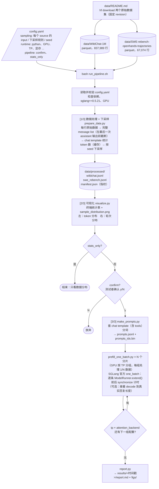

# PrefillBench：Prefill 效率评测

用于测量某张推理卡上 **Qwen3-8B-FP8 的纯 prefill 计算效率**。

每条测试请求都是一个完整的对话记录（message list，由 system / user / assistant / tool 消息组成），前面的所有消息都作为上下文。我们只测模型在开始生成 assistant 回复之前，处理这段上下文（prefill）的计算时间。

计时直接使用 SGLang 官方的 `one_batch` 基准工具：对每条请求调用一次 `ModelRunner.extend()`，前后各做一次 GPU 同步。这样**测到的只是 prefill 计算本身，不包含 server、HTTP、调度器、chunked prefill 等部署层面的开销**。

## 一条命令运行

先按 [`data/README.md`](data/README.md) 下载原始数据，然后执行：

```bash
bash run_pipeline.sh            # 读取 ./config.yaml
```

所有参数都写在 [`config.yaml`](config.yaml) 里，包括数据路径、下采样规则、使用哪个 python、哪几张 GPU 等。要用其他配置文件时，把路径传进去即可：`bash run_pipeline.sh my.yaml`。

另有两个可选开关，会覆盖 yaml 中对应的设置：

- `--stats-only`：只做数据处理和可视化，不跑测试；
- `--yes`：看完数据分布后不询问，直接开始测试。

## 流程图



## 运行流程

### 0. 准备环境和数据（测试者只需做一次）

```bash
pip install sglang==0.5.21 pyyaml pyarrow matplotlib
```

然后按 [`data/README.md`](data/README.md) 下载两个原始数据集，放到 `data/` 目录下，一共约 5.2 GB。

最后检查 `config.yaml` 的 `runtime` 一节，至少确认 `python`（装了上面这些包的那个 python）、`model`、`gpus` 三项。如果要计算 MFU，还需要填写 `peak_tflops`。

### 1. 读取配置并检查

[`scripts/load_config.py`](scripts/load_config.py) 会读取并校验 yaml，以下错误会直接报错退出：

- 缺少必填字段；
- source 的 `format` 不是支持的格式；
- `max_input_tokens` 没有小于 `context_length`；
- 长度分段不是递增的。

接着检查 `runtime.python` 能否导入所需的包、sglang 版本是否为 0.5.21、配置里的 GPU 编号是否存在。

本次使用的 `config.yaml` 会复制一份到结果目录，方便日后复现。

### 2. [1/3] 数据处理 + 下采样

[`scripts/prepare_data.py`](scripts/prepare_data.py) 对每个 source 依次做以下处理：

1. **转换**：每行原始数据转成一条 prefill 请求，也就是一个完整的 message list，在最后一次 assistant 输出之前截断，所以最后一条消息一定是 user 或 tool。
   - WildChat：每个对话一行。
   - SWE-rebench：每条 agent 轨迹一行，同时带上 `tools`（工具的 JSON schema）。
2. **统计长度**：用 Qwen3 的 chat template（`add_generation_prompt=True`、`enable_thinking=False`）计算每条请求的 prefill token 数。这一步耗时最长，单机约 10 分钟。结果会缓存在 `data/processed/.index/`，只要原始数据和 tokenizer 不变，之后换 seed 或换规则重新采样只需要几秒。
3. **下采样**：每个 source 单独执行，随机数生成器为 `numpy.random.default_rng([seed, crc32(source 名)])`：
   1. 丢掉 token 数小于 `min_tokens` 或大于 `max_input_tokens` 的行；
   2. token 数小于 `short_len` 的短请求，只按 `short_keep` 的比例随机保留；
   3. 在剩下的行中不放回地均匀抽 `num_samples` 条；如果不够，就全部保留。
4. **输出**：每个 source 生成一个 jsonl 文件，即 `data/processed/wildchat.jsonl` 和 `data/processed/swe_rebench.jsonl`。

**相同的原始数据、相同的规则，输出的文件逐字节一致。** `manifest.json` 里记录了被选中样本 id 的 sha256 指纹，不同的人可以用它核对抽到的是不是同一批数据。如果规则和原始数据都没有变化，这一步会被直接跳过。

输出 jsonl 的每一行格式如下，开头几个字段的顺序固定：

```json
{"id": "swe_rebench-chatcmpl-...", "source": "swe_rebench", "num_tokens": 46466, "num_turns": 45, "num_messages": 90,
 "num_output_tokens": 212,
 "meta": {"instance_id": "...", "repo": "...", "resolved": 1},
 "tools": [{"function": {"name": "execute_bash", "parameters": {...}}}],
 "messages": [{"role": "system", "content": "..."}, {"role": "user", "content": "..."},
              {"role": "assistant", "content": "...", "tool_calls": [...]},
              {"role": "tool", "content": "...", "tool_call_id": "..."}]}
```

- `num_tokens`：prefill 的 token 数。
- `num_turns`：上下文中 assistant 消息的条数加 1，也就是当前正在 prefill 的是第几轮。
- `num_output_tokens`：被截掉的那条 assistant 回复的 token 数，即这条请求在真实数据里的回复长度（WildChat 是原始回答，SWE 是 agent 的下一步，含 tool call）。只在完整生成测试中用作生成长度。

### 3. [2/3] 可视化

[`scripts/visualize.py`](scripts/visualize.py) 会在终端打印统计表，内容包括：

- 每个 source 的请求数、token 总数，token 长度的均值 / p50 / p90 / p99 / 最大值，以及轮次统计；
- 各长度区间的请求数，以及这些请求在总请求数、总 token 数中的占比。

同时保存一张图 `dataset/sample_distribution.png`：**左图是 token 分布，右图是轮次分布**，不同 source 用不同颜色区分。

如果 `pipeline.confirm` 为 `true`，测试者看完统计结果后需要输入 `y`，才会进入测试。

### 4. [3/3] 纯 prefill 测试

1. **分词**：[`scripts/make_prompts.py`](scripts/make_prompts.py) 把两个 jsonl 里的 `messages`（以及 `tools`）套上 chat template 并分词，结果写入 `prompts.jsonl` 和 `prompts_ids.bin`。
2. **计时**：[`scripts/prefill_one_batch.py`](scripts/prefill_one_batch.py) 基于 SGLang 官方的 `sglang.benchmark.one_batch`（[官方文档](https://github.com/sgl-project/sglang/blob/main/docs/docs/developer_guide/benchmark_and_profiling.mdx)），只替换了其中的 `load_model` 一个函数，其余逻辑都是官方原样。
   - 每个 rank 加载完模型后，逐条执行官方的 `extend()`，前后各调用一次 device synchronize 计时；
   - 跑完我们的数据后，再交回官方流程收尾。
3. **多卡**：GPU 按 `tp` 分组，每组独立处理一部分数据，相当于数据并行。例如 4 张卡、`tp: [1]` 时，会起 4 个进程，每个进程处理 1/4 的数据。如果 `tp` 或 `attention_backend` 写了多个值，会对每种组合各跑一遍。
4. **监控**：测试期间用 nvidia-smi 记录 GPU 利用率和功耗。
5. **完整生成测试（可选）**：把 `runtime.generation.enabled` 设为 `true` 后，每条请求 prefill 完会接着用官方的 `decode()` 逐个 token 生成，生成长度取数据中真实回复的长度（`num_output_tokens`，上限 `max_new_tokens`，且保证输入 + 输出不超过上下文长度），中途不因 EOS 停止，所以每次测试的生成长度完全一致。每一步 decode 前后都做 device synchronize，得到 **TTFT**（prefill 时间）、**TPOT**（每个输出 token 的时间）和 **端到端延迟**（TTFT + 全部 decode 时间）。这是单请求（batch size 1）的延迟测试，不代表服务端合批后的吞吐。

### 5. 报告

[`scripts/report.py`](scripts/report.py) 生成 `report.md`，内容包括：

- 本次使用的配置和运行环境；
- 数据分布；
- 每组配置的总 token 数、纯计算时间、**tok/s/GPU** 和 **MFU**；
- 按长度分桶统计的延迟（p50 / p90）、吞吐和 MFU；
- 延迟、吞吐、MFU 随输入长度变化的散点图，以及 GPU 利用率曲线；
- 开启完整生成测试时，另有 TTFT / TPOT / 端到端延迟 / decode 占比的总表、按输入长度分段的表和对应的图。

报告里数量类指标（请求数、token 数、耗时）是所有卡的合计，效率类指标（每卡 tok/s、延迟、MFU）是单卡口径，列名中都有标注。图都使用线性坐标：上排为完整长度范围，下排放大 0–16k。

## config.yaml 主要参数

| 位置 | 参数 | 默认值 | 说明 |
|---|---|---|---|
| `paths` | `processed_dir` | `data/processed` | 第 1 步的输出目录，存放两个 jsonl 和 manifest |
| | `out_dir` | `auto` | 可视化和测试结果的目录；`auto` 表示 `results/<时间戳>` |
| `processing` | `workers` | 0 | 第 1 步统计 token 数用的进程数；0 表示使用全部 CPU |
| `sampling` | `seed` | 20261013 | 下采样随机种子 |
| | `max_input_tokens` | 131000 | 请求长度上限，必须小于 `context_length` |
| | `sources[].format` / `input` | — | 原始数据格式（`wildchat` 或 `swe_rebench`）和 parquet 所在目录 |
| | `sources[].num_samples` | wildchat 90000 / swe 10000 | 每个 source 抽取的请求数 |
| | `sources[].short_len` / `short_keep` | wildchat 512 / 0.1 | 短 query 下采样规则：短于 `short_len` 的请求只保留 `short_keep` 比例 |
| `runtime` | `python` | `python3` | 装有 sglang==0.5.21 的 python 路径 |
| | `model` | `Qwen/Qwen3-8B-FP8` | 模型路径或 HF id |
| | `gpus` / `tp` | `[0]` / `[1]` | 使用的 GPU 编号和 TP 大小；`tp` 写多个值即扫参 |
| | `attention_backend` | `[default]` | attention backend，写多个值即扫参 |
| | `mem_fraction_static` | 0.7 | KV 池占用的显存比例。出现 OOM 时调小；日志出现 `skip ... > KV capacity` 时调大 |
| | `context_length` / `yarn` | 131072 / auto | 上下文长度；超过 40k 时自动开启 YaRN，并设置 `SGLANG_ALLOW_OVERWRITE_LONGER_CONTEXT_LEN=1`（否则 SGLang 会拒绝超过 40,960 的上下文） |
| | `batch_tokens` | 0 | 0 表示每条请求单独 prefill；大于 0 时，把多条请求拼进一次 `extend()`，总长度不超过这个值 |
| | `max_requests` | 0 | 每个分片最多跑多少条，0 表示不限。会在分片内均匀抽取，并一定包含最长的请求，所以小规模就能覆盖各种长度 |
| | `extra_server_args` | `""` | 其他 SGLang 参数，例如 `--fp8-gemm-backend cutlass` |
| | `peak_tflops` | 0 | 单卡峰值算力，用于计算 MFU；0 表示不计算 |
| | `generation.enabled` | false | 是否做完整生成测试（prefill 后接 decode） |
| | `generation.max_new_tokens` / `default_new_tokens` | 2048 / 256 | 生成长度上限；没有参考回复时使用的生成长度 |
| `pipeline` | `confirm` / `stats_only` | true / false | 测试前是否需要确认；是否只做数据处理和可视化 |

## 示例报告

[`reports/h20_prefill_generation_2026-10-14.pdf`](reports/h20_prefill_generation_2026-10-14.pdf)：在 2 张 H20 上跑 2,002 条请求（每张卡从 10 万条下采样数据中均匀抽 1,000 条，另含最长的一条），同时包含纯 prefill 和完整生成两部分结果。注意这次用的是本地打过补丁的 sglang 0.5.19（`allow_version_mismatch: true`），不是固定的 0.5.21。主要结果（单卡）：

| 输入长度 | prefill 每卡 tok/s | MFU（FP8 峰值 296 TFLOPS） | TTFT p50 | TPOT p50 | 端到端 p50（真实回复长度） |
|---|---|---|---|---|---|
| 512 – 1k | 13,756 | 66% | 52 ms | 6.1 ms | 2.6 s |
| 2k – 4k | 13,420 | 67% | 214 ms | 6.3 ms | 2.4 s |
| 8k – 16k | 11,222 | 67% | 1.0 s | 7.1 ms | 5.2 s |
| 32k – 64k | 5,959 | 58% | 8.3 s | 10.3 ms | 14.5 s |
| 64k – 128k | 4,212 | 55% | 15.6 s | 12.2 ms | 23.8 s |

## 目录与输出

```
data/
  README.md                         数据下载说明
  WildChat-1M/  SWE-rebench-openhands-trajectories/      原始数据（自行下载，不在 git 中）
  processed/                        第 1 步的输出
    wildchat.jsonl  swe_rebench.jsonl   下采样后的请求，每个 source 一个文件
    manifest.json  sample_index.csv     规则、计数、指纹，以及每条请求的长度和轮次
    .index/                             token 长度缓存
results/<时间戳>/
  config.yaml  sampling_config.json  env.txt
  dataset/      sample_manifest.json, sample_index.csv, sample_stats.json, sample_distribution.png,
                prompts.jsonl, prompts_ids.bin
  runs/<tp*_attn-*>/   batches_shard*.csv（每次 extend() 一行：tokens、latency_s、起止时间、ids）,
                       summary_shard*.json, shard*.log, cmd_shard*.txt, gpu_monitor.csv
  report.md  figs/
```

## 版本与依赖

- **SGLang 固定为 0.5.21**，它会同时锁定 `torch==2.13.0` 和 `transformers==5.12.1`。固定版本有两个原因：
  - 不同版本的 kernel 和默认 backend 不同，测出的结果不可比；
  - 第 3 步依赖官方 `one_batch` 模块内部的函数。

  因此 sglang 版本不一致时，流程会直接报错退出。确实需要使用其他版本时，可以设置 `runtime.allow_version_mismatch: true`，此时只打印警告。
- `prefill_one_batch.py` 已对照 0.5.21 的官方源码核对过，依赖以下接口：`load_model`、`prepare_synthetic_inputs_for_latency_test`、`_TorchBenchRunner` 的 `clear` / `extend` / `synchronize`、`main`、`BenchArgs`。
- 其他依赖：
  - Python 包：`pyyaml`（读取配置）、`pyarrow`（读取 parquet）、`numpy`、`matplotlib`；
  - 系统工具：`nvidia-smi`、`setsid`。
- 读取 yaml 时默认使用 PATH 中的 `python3`，可以用环境变量 `GPUBENCH_PYTHON` 指定其他 python；后续所有步骤都用 `runtime.python` 执行。

## 注意事项

- **耗时**：默认配置共 10 万条请求、约 7.1 亿 token。其中 SWE 只有 1 万条，却贡献了约 77% 的 token，而且上下文很长，attention 计算量大。按 FLOPs 粗估，单卡纯计算需要 14–37 小时。想先快速看趋势，可以调小 `num_samples`，或者设置 `max_requests`。
- **显存**：测试不做 chunked prefill，一条 128k 的请求会在一次前向中完成，激活值占用的显存较多。因此 `mem_fraction_static` 默认只设为 0.7，为激活值留出空间。建议先设 `max_requests: 50` 试跑一下。
- **长度分布**：WildChat 的请求集中在 0.5k–4k token，SWE 集中在 32k–128k，8k–32k 之间的样本很少。
